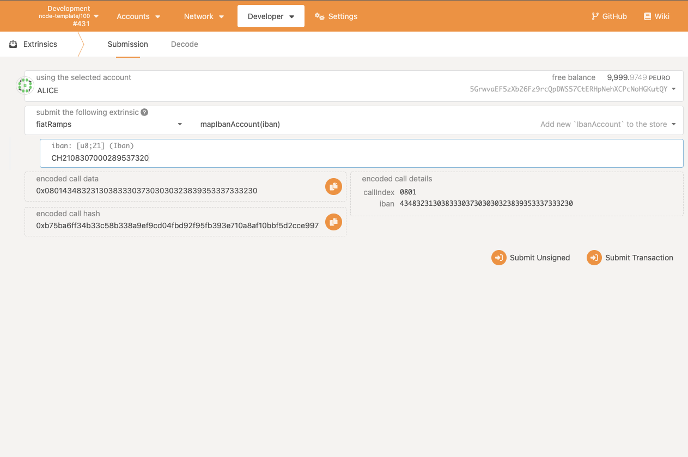
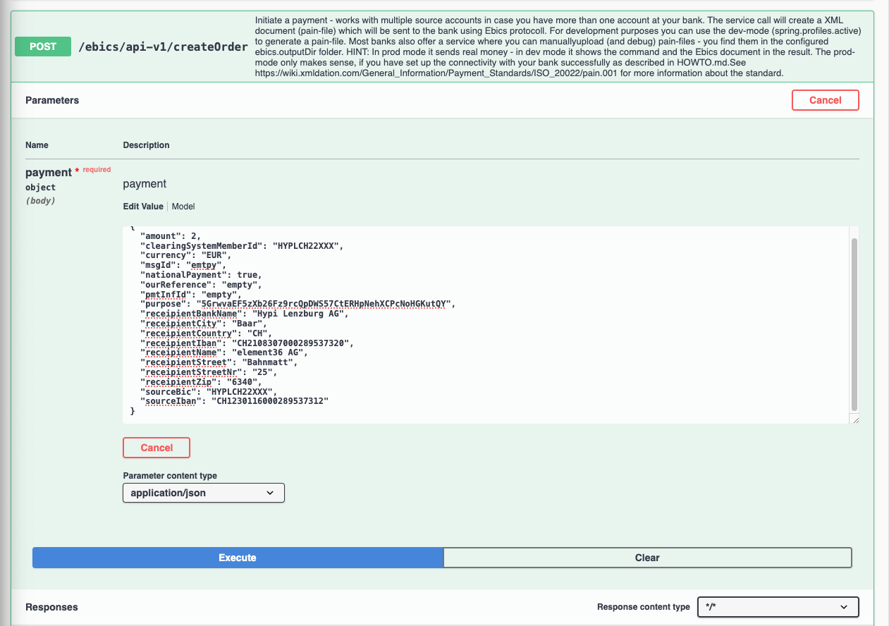
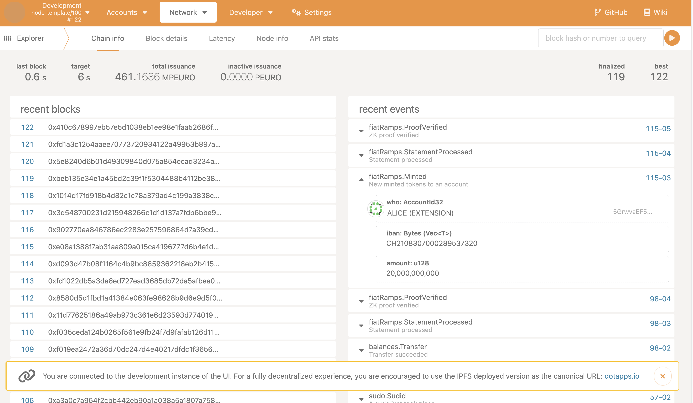
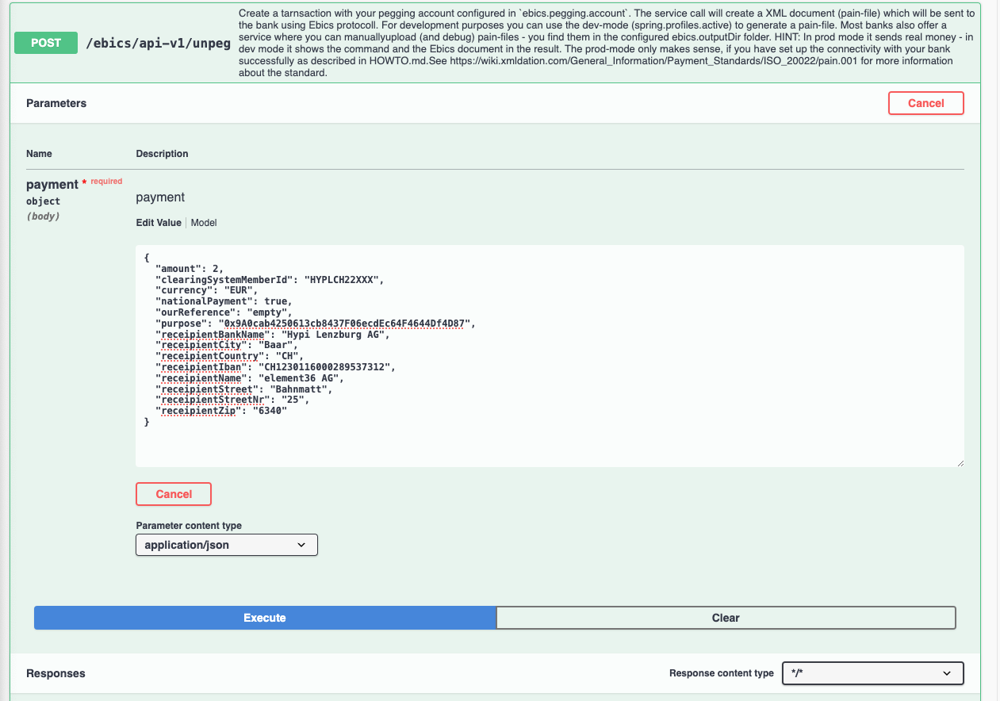
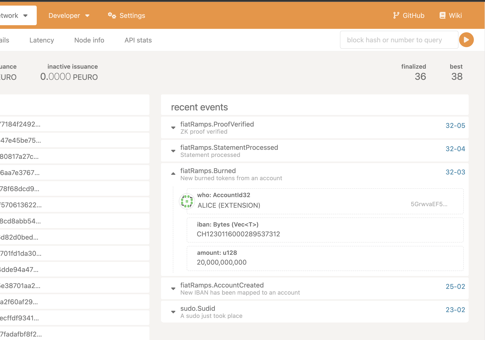
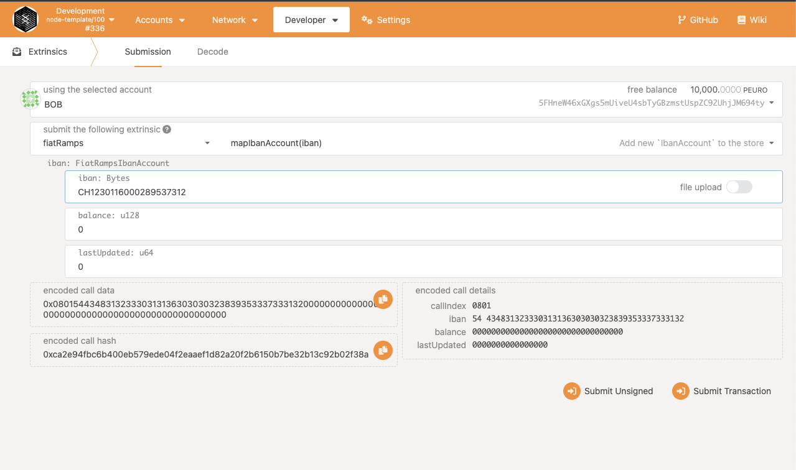
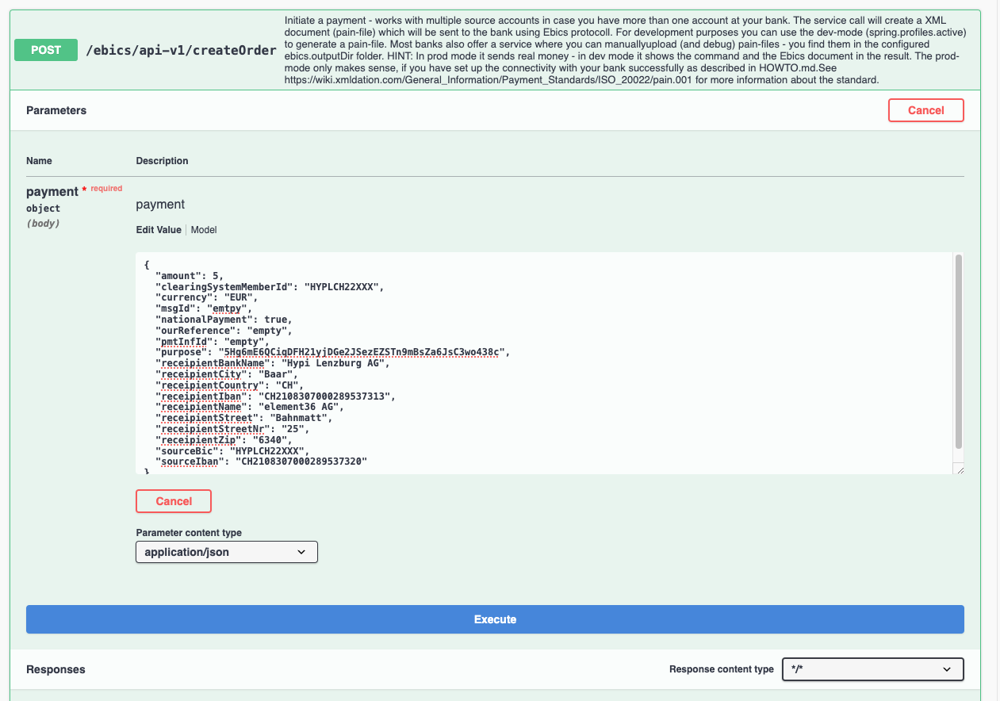
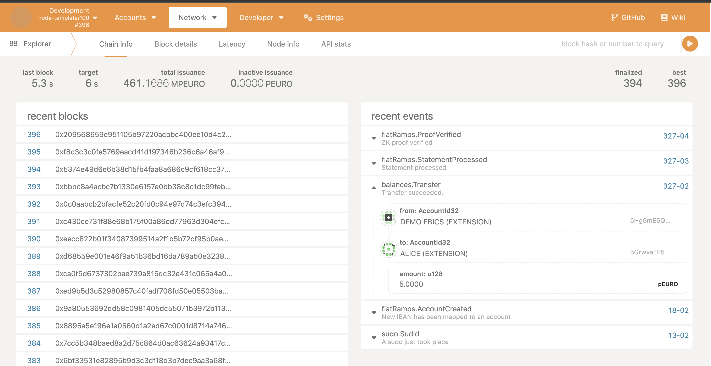
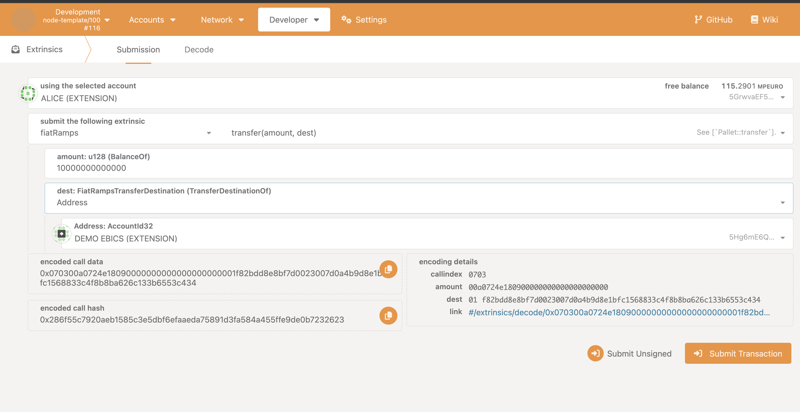
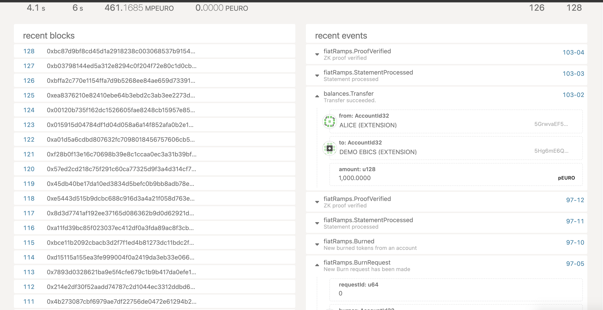

# Intro

This document describes in-depth how our chain functions and how to test it out.

## Hyperfridge workflow

Hyperfridge is a chain that aims to connect EBICS banking interface to Polkadot ecosystem. In order to accomplish it, we utilise Substrate offchain-workers. With the help of offchain-workers, our node syncs with our EBICS server and EBICS Java service. And with mapping our bank account to an `account` chain, we get an easy way to ramp on and off from chain.

Below is the workflow for easily ramping on and off to our chain:

- First and foremost, every user that wants to connect their bank account to FiatRamps, needs to call `createAccount` extrinsic
- Once on-chain account is mapped to off-chain bank account, user can perform following actions:
  - Burn funds, i.e withdraw from bank account
  - Transfer funds to IBAN, i.e transfer funds to another IBAN account
  - Transfer funds to account, i.e transfer funds to another account on-chain

In order to move funds from their bank account, EBICS users call `/unpeg` API call providing neccessary recipient details.

Our pallet exposes a single extrinsic that can be used to transfer or withdraw funds from the bank account that supports EBICS standard. This extrinsic is called `transfer` and it has following parameters:

- `amount` - specifies the amount of funds to be transferred
- `dest` - a custom enum that specifies the destination of the transfer. It can be either `Address` or `Iban` or `Withdraw`. If `Address` is chosen, then `dest` field should contain an on-chain account address. If `Iban` is chosen, then `dest` field should contain an IBAN number. `Withdraw` does not require any additional parameters.

It is important to note that transferring or withdrawing is not a synchronous process. This is because finality of transactions in EBICS standard is not instant. To handle this issue, our pallet also serves as escrow.

Whenever someone calls one of the above extrinsics, an `amount` of the transfer is transferred to Pallet's account and a new `BurnRequest` instance is created. `BurnRequest` struct contains id, source, destination and amount of the transfer.

The reason why we don't instantly send `unpeg` request to the API, is that we can't send HTTP call outside of Offchain Worker context. Therefore we store requests to *burn* funds from bank account and offchain worker processes it later. For each burn request, an `unpeg` request is sent.

Burn request is removed from the storage once the transaction is confirmed by EBICS API, i.e when it ends up as an outgoing transaction in the bank statement.

Below is a tutorial that demonstrates how our Substrate solo chain works.

## Setup

To get started, obviously make sure you have the necessary setup for Substrate development.

## Setup Zombienet

You should have [`zombienet`](https://github.com/paritytech/zombienet) installed, at least version `1.3.104`.

Compile the node:

```bash
cargo build --release
```

Then, since Hyperfridge is a parachain, it requires a local network which consists of a relay chain and Asset Hub for XCM compatibility. You will need a compiled `polkadot` and `polkadot-parachain` binaries. Check out `polkadot-sdk` and:

Build `polkadot`:
```
cd polkadot && cargo install --path . --locked --features fast-runtime
```
`fast-runtime` feature is important, because otherwise you will have to wait a long time until `parachains` start producing blocks.

And then `polkadot-parachain` binary for `Asset Hub`:

```
cargo build --release --locked -p polkadot-parachain-bin --bin polkadot-parachain
```

And now, you should point path to those binaries in ENV variables:

```
export POLKADOT_BIN=/path/to/polkadot
export ASSET_HUB_BIN=/path/to/polkadot-parachain
```

Finally:

```
zombienet spawn -p native zombienet.toml
```

The log will print `Polkadot.js` links to all nodes.

## Demo

### Prepare XCM

#### HRMP Channels
First of all, we should have `hrmp` channels open between two parachains. For this, we dispatch a `Sudo` call from relaychain `hrmp.ForceOpenHrmpChannel`:


This opens a channel from `Hyperfridge` to `AssetHub`, change the values of `sender` and `recipient` to open the channel in other direction, and submit the extrinsic.

Now, another key thing for the demo is the registration of `Hyperfridge` pEURO stablecoin on Asset Hub. For this, we also need to dispatch a sudo call from relay chain that registers the foreign asset and sets it as a sufficient asset. Sufficiency of the stablecoin is important, because we need to be able to pay transaction fees and satisfy existential deposit with it.

First, go to `Asset Hub` extrinsics tab and fill it with these values:


Here, location of the asset is our `Hyperfridge` chain with `2000` para ID and admin is the sovereign account of our parachain in `Asset Hub`. Also, make sure to set a positive value for minimum balance. Do not dispatch the extrinsic, just copy the `encoded data` of the call.

And in the transfer tab, send some funds to sovereign account of relay chain in `Asset Hub` (`5Dt6dpkWPwLaH4BBCKJwjiWrFVAGyYk3tLUabvyn4v7KtESG`):


#### Foreign assets creation

Head over to relay chain and send a `Transact` XCM message wrapped in `Sudo` to the `Asset Hub`:


The values can be easily confused, so these are common values that you can copy:

```
WITHDRAW and BUY_EXECUTION amount is 1 UNIT: 1000000000000 and to be paid in WND currency, hence MultiLocation { Parents: 1, Interior: Here }
Safe weight values for TRANSACT: Weight { ref_time: 500000000000, proof_size: 60000 }
Relay chain sovereign account in Asset Hub: 5Dt6dpkWPwLaH4BBCKJwjiWrFVAGyYk3tLUabvyn4v7KtESG
Hyperfridge sovereign account in Asset Hub: 5Eg2fntJ27qsari4FGrGhrMqKFDRnkNSR6UshkZYBGXmSuC8
Transact OriginKind should be SUPERUSER, this is extra important.
```


Submit the sudo call, and this should be the last step of preparation. If succesfull, you will see this in the `Asset Hub` explorer:


### Hyperfridge

### Fetch proofs for transfers

By running a local [`ebics-demo`](./ebics-demo), you can also fetch proofs for transfers. And you can verify them using the hyperfridge verifier.

Start the Demo React app:

```
cd ebics-demo
yarn && yarn start
```

Go to http://localhost:8000/proofs and you will see empty statements:

For new statement to appear, we need to trigger a transfer. The easiest way is by creating an order in the Swagger UI for EBICS API. Simply repeat the step at [Stablecoins are minted to Alice] section below.

Then you can download the proofs as json:

#### Image ID

And you also need to get the image ID of the `hyperfridge` `riscv0` module. You can get it by running the following command:

```bash
docker compose run hyperfridge cat /app/IMAGE_ID.hex

dcaba464d4909890d6638dd14e7a25853a8dd2cad14639d0d310987b32a43957
```

Copy that image ID and pass it to the sudo extrinsic when the chain is running.

Insert image ID with `fiatRamps::setRisc0ImageId` extrinsic call. This is necessary for offchain worker to know which image to use when running the `riscv0` module. Go to `Sudo` tab and choose `fiatRamps -> setRisc0ImageId` extrinsic and paste the image ID from the previous step, make sure to prepend the image ID with `0x`. Click `Submit transaction`. Sudo account is a development account `Dave`.


Open PolkadotJs [interface](https://polkadot.js.org/apps/?rpc=ws%3A%2F%2F127.0.0.1%3A9944#/explorer) and go to `Developer -> RPC calls` page. Here, we first need to enter keypair for our offchain worker, since it will be signing and submitting transactions to the chain. Choose `author -> insertKey` RPC call and fill out the fields with the following values:

```js
key_type: ramp
suri: cup swing hill dinner pioneer mom stick steel sad raven oak practice
public_key: 5C555czPfaHgYhKhsRg2KNCLGCJ82jVsvweTHAnfvT83uy5T
```

Then, choose `FiatRamps.setApiUrl` extrinsic and paste the new url for the API and click `Submit transaction`. This is only necessary if you have a different URL than the default one with Ebics Java service.

Once you have submitted the call, head over to `Extrinsics -> fiatRamps -> createAccount` call. Here we need to map Alice's IBAN number to his on-chain account address. Simply choose Alice as a signer, copy and paste value of the IBAN number from the following JSON file and submit the extrinsic.

```json
{
  "accounts" : [ {
    "ownerName" : "Alice",
    "iban" : "CH2108307000289537320",
    "accountId": "5GrwvaEF5zXb26Fz9rcQpDWS57CtERHpNehXCPcNoHGKutQY",
  }, {
    "ownerName" : "Jack",
    "iban" : "CH2108307000289537313",
    "accountId": "5Hg6mE6QCiqDFH21yjDGe2JSezEZSTn9mBsZa6JsC3wo438c",
    "seed": "0x5108e950fb18a11a372da602c1714f289002204a8003748263bb9c351b57d3aa"
  }, {
    "ownerName" : "Bob",
    "iban" : "CH1230116000289537312",
    "accountId": "5FHneW46xGXgs5mUiveU4sbTyGBzmstUspZC92UhjJM694ty",
  } ]
}
```

`Jack's` IBAN comes mapped in genesis, so we don't need to map it again.



### Stablecoin pallet

Stablecoin pallet is just another instance of `pallet_balances` and it is a representation of the stable coin that is on/off ramped from the EBICS banking interface. So, in order to check your allowance, you have to check from `Chain State` and `stableCoin.Accounts`:


#### Stablecoins are minted to Alice

Stablecoins are minted only when offchain worker detects an incoming transaction from an unknown IBAN address, i.e from an IBAN address is not mapped to any on-chain account address. In order to see how it works in action, head over to the EBICS service [API](http://w.e36.io:8093/ebics/swagger-ui/?url=/ebics/v2/api-docs/#/). Open `/ebics/api-v1/createOrder` tab and fill out Bob's details. Namely, we will fill `purpose` field with Alice's on-chain account and `receipientIban` field with her IBAN number. Fill out Bob's IBAN from above JSON file as the `sourceIban`. Finally, use these values and execute the call:
```
amount: 2 (or any other amount)
purpose: 5GrwvaEF5zXb26Fz9rcQpDWS57CtERHpNehXCPcNoHGKutQY
receipientIban: CH2108307000289537320
sourceIban: CH1230116000289537312
```



Then wait a little bit until offchain worker picks up the statement. After some time (3-5 blocktimes) you should see that new tokens were minted:



This is how new stablecoins are minted in our chain.

### Stablecoins are burned from Alice

Now, in order to see how burning works, we can either go to EBICS service again and call `/ebics/api-v1/unpeg` request or submit `fiatRamps.transfer` extrinsic. Let's use EBICS service again, as extrinsic calls are covered in the next demos. After filling up the `recipientIban` field with these values:

```
amount: 1 (or any other amount)
receipientIban: CH1230116000289537312
```



Again, we wait for offchain worker to process the statement and shortly after we should see that it emits a Burn event:



#### Alice transfers to Jack via EBICS API

For this part of the tutorial we will need to map Jack and Bob's IBAN numbers to their on-chain account addresses. We submit `createAccount` extrinsic with IBAN addresses of Jack and Bob, respectively, making sure that they are signing the extrinsic call. For example, Bob mapping his account would look like this:



It is also very important to know that we can not use PolkadotJS transfer button to move funds in our chain. This would break synchronization between the bank account balance and on-chain balance. In the future it should be disabled and the only way to transfer should be via burn requests.

To make a transfer from Alice to Jack, we head over to our EBICS service [API](http://w.e36.io:8093/ebics/swagger-ui/?url=/ebics/v2/api-docs/#/). We open `/ebics/api-v1/createOrder` tab and fill out Jack's details. Namely, we will `purpose` field with Jack's on-chain account and `receipientIban` field with his IBAN number. And `sourceIban` field with Alice's IBAN number. We can then specify the amount and other fields:

```
amount: 1 (or any other amount)
purpose: 5Hg6mE6QCiqDFH21yjDGe2JSezEZSTn9mBsZa6JsC3wo438c
receipientIban: CH2108307000289537313
sourceIban: CH2108307000289537320
```



This will create a new order and will end up in Alice's bank statement as an outgoing transaction. And when our offchain worker queries bank statements, it will parse Jack's on-chain account from `reference` field or query it from storage using his IBAN number. Note that transfer on-chain won't happen instantly, since offchain worker performs activities within a minimum of 5 block times interval (~30 seconds) and there are 3 types of actions. So, there is around 90 seconds of time between each new bank statements processing.

Once offchain worker has processed new statements, two `Transfer` events occur:



#### Alice transfers to Jack via Extrinsic

We go to `Extrinsic` tab, choose `fiatRamps.transfer` extrinsic call and choose `destination` as `Address`. Fill out the necessary fields and make sure that the amount is a positive number and more than 1 UNIT (10 decimals), otherwise extrinsic will fail.

```
amount: 10000000000
dest: Address(5Hg6mE6QCiqDFH21yjDGe2JSezEZSTn9mBsZa6JsC3wo438c)
```



After we submit extrinsic, we can see that the burn request event is created.

Shortly after (approximately 3-4 blocks), we can notice that the burn request has been processed and transfer between Alice and Jack occurs. Notice that transfer occurs from an unknown wallet to Jack, not directly from Alice to Jack. This is offchain worker's account that stores the funds until transaction is finalized by LibEUfin backend.



#### Alice teleports stable coin to Asset Hub

Go to Extrinsics tab and submit `teleportToAssetHub` extrinsic:


Head over to `Asset Hub` explorer and watch until the tokens are minted:


#### Alice teleports back to Hyperfridge to Bob

In `Asset Hub`, check Alice balance in `foreignAssets.account` (you can use this balance to send it back in the next step):


Since there is no wrapper extrinsic on `Asset Hub` we need to manually send the tokens via `polkadotXcm.teleportAssets`:


And, obviously, head back to `Hyperfridge` explorer and notice that tokens are minted back.

## Ebics Java Service (Optional)

You don't need to run the EBICS Java service, since we use the hosted version [at](http://w.e36.io:8093/ebics). However, if you want to run it locally, you can do so by following the instructions below.

This service is responsible for connecting to the bank account and providing an API for our offchain worker to interact with. You can find instructions for running the service [here](https://github.com/element36-io/ebics-java-service/blob/hyperfridge/docs/TEST.md#run-and-test-with-docker):

Or manually, make sure you cloned [`ebics-java-service`](https://github.com/element36-io/ebics-java-service) and switch to `hyperfridge` branch:

```
docker compose pull
docker compose up -d
# optional
docker compose logs -f
```

Then, you should do a sudo extrinsic `fiatRamps.setApiUrl` and set the new URL to `http://localhost:8093/ebics`. This will make sure that offchain worker is querying the correct API.
